  

  

  
  
  
  

---

## Sobre

Sou **Brenno Leon de Souza Amaral**, designer gráfico e front-end, com foco em **web design** e **projeção de interfaces**. Programo desde os 10 anos e hoje crio sites, componentes e experiências visuais com atenção ao detalhe, ao movimento e à performance.

Meu objetivo é construir sites que disputem prêmios de design, como o **Awwwards**, unindo estética refinada com código limpo.

Também atuo em **motion design**, **edição de vídeo** e **social media**, o que me dá uma visão completa do ciclo de uma peça: da ideia visual até a entrega no código ou na tela.

## Áreas de atuação

| Área | O que faço |
|---|---|
| 🎨 **Web Design** | Direção de arte, layouts, sistemas visuais e sites de alto nível estético |
| 🧩 **Front-end** | Interfaces responsivas, animações, componentes e interações em HTML, CSS e JavaScript/TypeScript |
| 🎞️ **Motion Design** | Microinterações, transições e animações para web e vídeo |
| 🎬 **Edição de vídeo** | Edição, ritmo e finalização para redes sociais |
| 📱 **Social Media** | Conteúdo visual pensado para plataformas e formatos verticais |
| 🖥️ **Projeção de interfaces** | Protótipos e interfaces desenhados no Figma e no Figcraft, prontos para implementação |

## Stack

  
  
  
  
  
  
  

- **Front-end:** HTML, CSS, JavaScript e TypeScript, com foco em animação e interfaces expressivas
- **Sistemas:** Node.js e Rust, com noções básicas de segurança da informação
- **Design:** Figma, Figcraft e direção de arte para web
- **Vídeo e movimento:** edição, motion design e produção para redes sociais

## Projetos em destaque

| Projeto | Descrição |
|---|---|
| [**Portfólio**](https://github.com/AnThophicous/AnThophicous.github.io) | Site pessoal de design e front-end |
| [**LuxoBrowser**](https://github.com/AnThophicous/luxo-browser) | Fork experimental do Firefox 159 com foco em interface limpa, dinâmica e leve |
| [**FitaSign**](https://github.com/AnThophicous/FitaSign) | Editor desktop open-source de interfaces Roblox (TypeScript, Electron, Luau e MCP) |
| [**parede-da-ia**](https://github.com/AnThophicous/parede-da-ia) | Motor de direção de arte que dá a agentes de IA o padrão de design de sites premiados |
| [**Slate**](https://github.com/AnThophicous/Slate) | Toolkit de interface de terminal em Rust, com suporte a Node.js e TypeScript |
| [**Cobault-Backend**](https://github.com/AnThophicous/Cobault-Backend) | Baixador de mídia em C com HTTP paralelo e suporte a HLS |

## Estatísticas

  
  

  

---

## Contato

Quer conversar sobre um projeto ou uma parceria? Veja meu [portfólio](https://github.com/AnThophicous/AnThophicous.github.io) ou abra uma issue em qualquer um dos repositórios.
