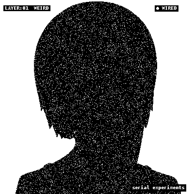

<p align="center">
  
</p>

<p align="center">
  <a href="https://github.com/AnThophicous">
    
  </a>
</p>

<p align="center">
  
  
  
  
  
</p>

<p align="center"></p>

## `LAYER:01` — WEIRD

<p align="center">
  
</p>

> Opa! Eu sou o **AnThophicous** 👋 — um desenvolvedor brasileiro de **16 anos**, apaixonado por tecnologia, programação e Inteligência Artificial.
>
> Hoje atuo mais no **Front-end**, mas estou expandindo pra **Backend com TypeScript**, desenvolvimento de sistemas e **Cyber Security**.

<p align="center"></p>

## `LAYER:07` — SOCIETY

<table>
<tr>
<td width="50%" align="center">
  
</td>
<td width="50%">

```text
   ┌────────────────────────────────────┐
   │  SERIAL EXPERIMENTS LAIN  (1998)   │
   └────────────────────────────────────┘

   > present day.
   > present time.
   > HAHAHAHAHA

   "no matter where you go,
    everyone's connected."

   o mundo real e a Wired
   não são tão separados
   quanto parecem.

   é por isso que eu programo.
```

<sub><code>lain_dither.py</code> → dithering Atkinson 1-bit · luz em movimento · sombra projetada · glitch · desligamento de CRT</sub>

</td>
</tr>
</table>

<p align="center"></p>

## `LAYER:03` — PSYCHE

<details>
<summary><code>$ cat ~/minha_historia.txt</code> &nbsp;<sub>(clica pra abrir)</sub></summary>
<br/>

Provavelmente você chegou aqui pelos meus projetos… ou talvez queira me conhecer melhor. Então deixa eu te contar.

```diff
@@ ~10 anos @@
+ jogos de navegador: MooMoo.io, Zombs.io e outros .io
+ ficava fascinado tentando entender como aqueles jogos funcionavam
+ mesmo sem saber programar direito, já queria criar algo parecido

@@ 12 anos @@
- me afastei um pouco da programação

@@ 13 anos @@
+ voltei de verdade: HTML, CSS, JavaScript, TypeScript
+ servidores, backend, APIs e sistemas
+ conheci a fundo as Inteligências Artificiais (GPT-4o mudou tudo)

@@ hoje — 16 anos @@
+ duas paixões: programação + inteligência artificial
+ projetos reais, errar, corrigir e aprender na prática
```

Também estudei **Engenharia de Prompt**, incluindo o método **T.I.C.**:

| `T` | `I` | `C` |
|:---:|:---:|:---:|
| **Task** | **Instructions** | **Context** |

Esse método me ajudou a pensar melhor, organizar ideias e criar prompts mais eficientes.

Eu nunca gostei de apenas assistir aulas e guardar conhecimento. **Eu gosto de aplicar.** Mesmo ainda sem experiência profissional em empresas, estou construindo uma base forte com estudo, prática e projetos próprios.

Além da parte técnica, venho aprendendo bastante sobre maturidade, disciplina e crescimento pessoal — foco, respeito, espaço pessoal e evolução como pessoa. Usei tudo isso como motivação pra voltar ainda mais forte.

</details>

<p align="center"></p>

## `LAYER:04` — RELIGION

<p align="center">
  
</p>

<p align="center"><sub>a obra de Michelangelo convertida em ASCII a partir do próprio afresco · os dedos se aproximam, mas nunca se tocam</sub></p>

<p align="center"></p>

## `LAYER:09` — PROTOCOL

```console
anthophicous@wired:~$ apt list --installed
```

<p>
  
  
  
  
  
  
  
</p>

```console
anthophicous@wired:~$ apt install --future
```

<p>
  
  
  
  
  
  
</p>

<p align="center"></p>

## `LAYER:11` — INFORNOGRAPHY

<p align="center">
  
</p>

<p align="center">
  
  
</p>

<p align="center">
  
  
</p>

<p align="center">
  <picture>
    <source media="(prefers-color-scheme: dark)" srcset="https://raw.githubusercontent.com/AnThophicous/AnThophicous/output/snake-dark.svg" />
    <source media="(prefers-color-scheme: light)" srcset="https://raw.githubusercontent.com/AnThophicous/AnThophicous/output/snake-light.svg" />
    
  </picture>
</p>

<p align="center"></p>

## `LAYER:13` — EGO

```console
anthophicous@wired:~$ cat /etc/objetivos
```

| | |
|---|---|
| 🎯 **onde quero chegar** | Google · Microsoft · OpenAI · Anthropic · Big Techs do Vale do Silício |
| 🧠 **o que importa mais** | construir coisas incríveis, aprender sempre e deixar minha marca na tecnologia |
| ⚡ **foco de hoje** | **aprender, construir e evoluir.** |

<details>
<summary><code>$ cat ~/curiosidades</code></summary>
<br/>

- 🇧🇷 Brasileiro, 16 anos
- 💻 Desenvolvedor Front-end
- 🚀 Aprendendo Backend com TypeScript
- 🤖 Apaixonado por Inteligência Artificial
- 🔒 Interessado em Cyber Security
- 🐧 Fã de Linux e de Serial Experiments Lain
- 📚 Sempre estudando e criando projetos
- 🗣️ Consigo conversar um pouco em inglês
- ⚡ Gosto de transformar ideias em projetos reais

</details>

```console
anthophicous@wired:~$ fortune | cowsay -f tux
```

```text
 _________________________________________________
/ Eu não quero apenas estudar programação.        \
\ Eu quero construir coisas que impactem pessoas. /
 -------------------------------------------------
   \
    \
        .--.
       |o_o |
       |:_/ |
      //   \ \
     (|     | )
    /'\_   _/`\
    \___)=(___/
```

<p align="center">
  
</p>

<p align="center"><sub>tudo aqui (ASCII, SVGs animados, a Lain em dithering) é gerado por código em <a href="scripts/"><code>scripts/</code></a> 🐧</sub></p>
